<div align="center">

<a href="https://rovervilla.space">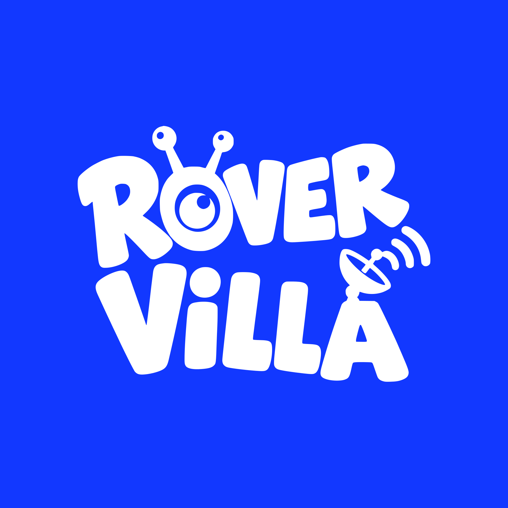</a>

# Rover Villa

### They never came back. So we bring their stories home.

A free, fact-checked home for the 15 machines humanity left on Mars and the Moon,<br>
told through comics, cartoons, games and 3D models, for curious kids and grown-ups alike.

**[Visit rovervilla.space →](https://rovervilla.space)**

[](https://nextjs.org)
[](https://react.dev)
[](https://tailwindcss.com)
[](https://threejs.org)
[](https://www.typescriptlang.org)
[](https://workers.cloudflare.com)

<br>

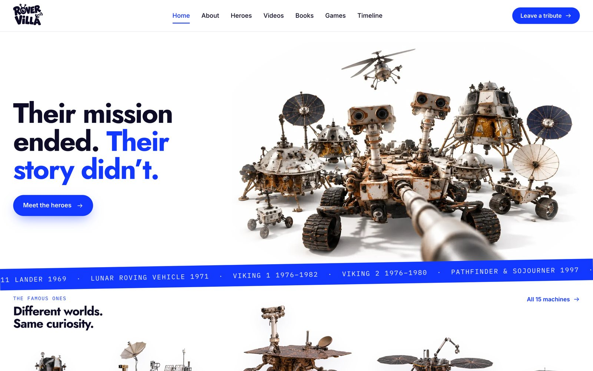

</div>

<br>

Rovers, landers and probes went where we couldn't, and they never came back. Their missions are over, but they are still out there, on the plains of Mars and the dust of the Moon. Rover Villa remembers them the way we remember great people: where they were born, the life they lived, what they discovered, and their last signal home.

Everything you read here can be traced back to a real mission record. That was the rule from day one.

<table>
  <tr>
    <td align="center"><h2>15</h2>machines</td>
    <td align="center"><h2>15</h2>illustrated books</td>
    <td align="center"><h2>86</h2>chapters</td>
    <td align="center"><h2>9</h2>browser games</td>
    <td align="center"><h2>8</h2>cartoon episodes</td>
    <td align="center"><h2>5</h2>NASA 3D models</td>
    <td align="center"><h2>113</h2>NASA archive photos</td>
    <td align="center"><h2>196</h2>source links</td>
  </tr>
</table>

## Contents

- [Meet the residents](#meet-the-residents)
- [What's inside](#whats-inside)
- [Built on real records](#built-on-real-records)
- [How it's built](#how-its-built)
- [Run it yourself](#run-it-yourself)
- [Credits](#credits)

---

## Meet the residents

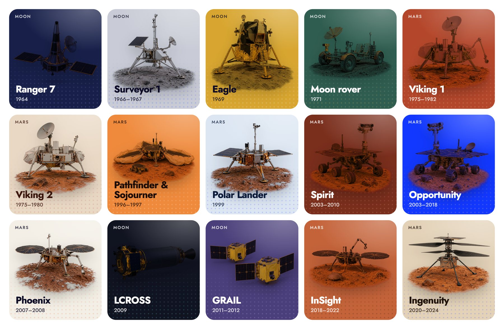

| Machine | World | What it was | Years | Where it rests | How it ended |
|---|---|---|---|---|---|
| **Ranger 7** | Moon | Impactor | 1964 | Mare Cognitum | Impact, 31 Jul 1964 |
| **Surveyor 1** | Moon | Lander | 1966–1967 | Oceanus Procellarum | Last signal, 7 Jan 1967 |
| **Apollo 11 lander** · *Eagle* | Moon | Lander | 1969 | Tranquility Base | Left behind, 21 Jul 1969 |
| **Lunar Roving Vehicle** · *LRV-1* | Moon | Rover | 1971 | Hadley–Apennine | Last signal, 2 Aug 1971 |
| **Viking 1** | Mars | Lander | 1975–1982 | Chryse Planitia | Last signal, 11 Nov 1982 |
| **Viking 2** | Mars | Lander | 1975–1980 | Utopia Planitia | Last signal, 11 Apr 1980 |
| **Pathfinder & Sojourner** | Mars | Lander + rover | 1996–1997 | Ares Vallis | Last signal, 27 Sep 1997 |
| **Mars Polar Lander** | Mars | Lander | 1999 | Planum Australe (presumed) | Lost on arrival, 3 Dec 1999 |
| **Spirit** | Mars | Rover | 2003–2010 | Gusev crater | Last signal, 22 Mar 2010 |
| **Opportunity** · *Oppy* | Mars | Rover | 2003–2018 | Meridiani Planum | Last signal, 10 Jun 2018 |
| **Phoenix** | Mars | Lander | 2007–2008 | Vastitas Borealis | Last signal, 2 Nov 2008 |
| **LCROSS** | Moon | Impactor | 2009 | Cabeus crater | Impact, 9 Oct 2009 |
| **GRAIL** · *Ebb & Flow* | Moon | Twin orbiters | 2011–2012 | Sally K. Ride Impact Site | Impact, 17 Dec 2012 |
| **InSight** | Mars | Lander | 2018–2022 | Elysium Planitia | Last signal, 15 Dec 2022 |
| **Ingenuity** · *Ginny* | Mars | Helicopter | 2020–2024 | Jezero crater | Final flight, 18 Jan 2024 |

Years run from launch to the end of the mission. Every date in this table comes from `lib/heroes.ts`, where each machine lists its sources.

---

## What's inside

### 📚 Read their stories


Every machine has its own illustrated book, told in its own voice: **15 books and 86 chapters**, each chapter one true event.

- **Two ways to read.** A comic with panels, speech bubbles and sound effects, or a calm storybook. Both have adjustable text size and a **read-aloud** button.
- **Real pictures inside.** Comic panels mix archive photos from the NASA Image and Video Library, each credited on the panel, with illustrations of the machine.
- **Every chapter ends with a fact file.** The key numbers, each with its own source link, plus the chapter's main mission record.
- **Your place is remembered.** Progress and finished chapters are saved in the browser. Finish a chapter and you get confetti.

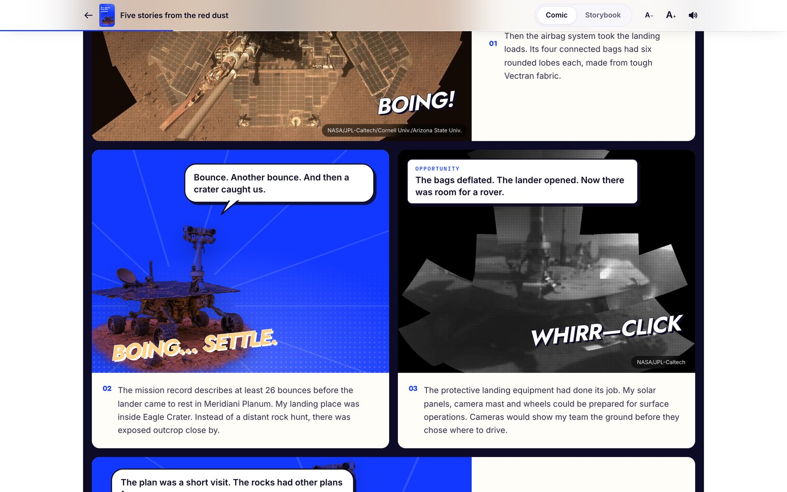


> The machines' first-person lines are imagined retellings, not transmissions, and each book says so. The events, dates and numbers are real.

### 🎮 Play the missions

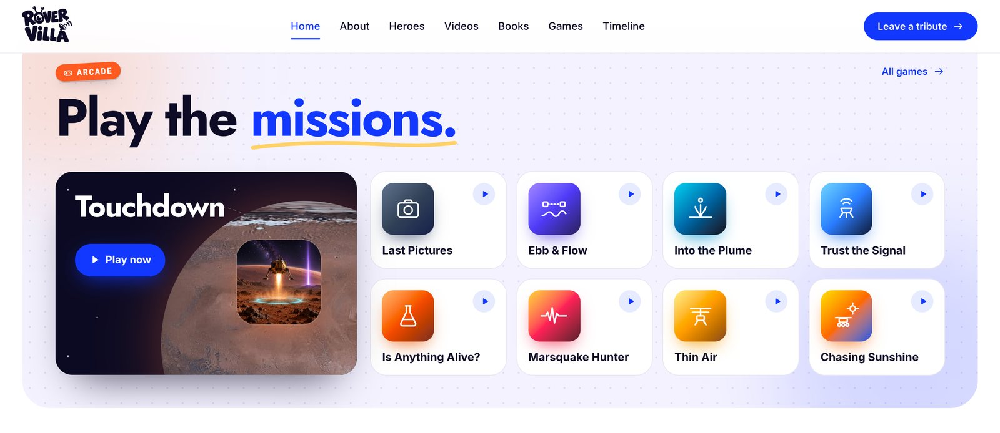

Nine free games that play right in the browser. Each one turns a real moment from a mission into something you can do with your own hands. Then it shows "The real story": the actual facts, with sources.

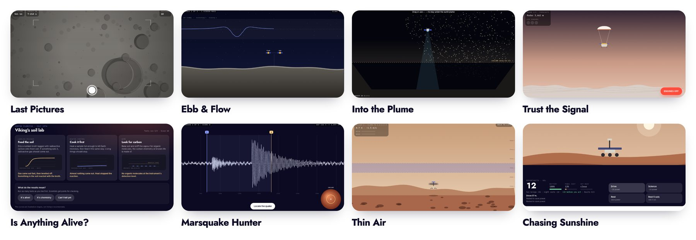

| Game | You get to… | Real facts shown |
|---|---|---|
| **Touchdown** | Land on Mars and the Moon and find the machines we left there, in 3D | Every machine's resting place and how its mission ended |
| **Last Pictures** · Ranger 7 | Fall toward the Moon and keep taking pictures | 4,308 pictures in the last 17 minutes; first picture from 2,110 km; impact at 2.62 km/s |
| **Ebb & Flow** · GRAIL | Find hidden masses under the Moon from two spacecraft | The range-rate radio link, mascons, the 17 Dec 2012 impact |
| **Into the Plume** · LCROSS | Hit a dark crater, then fly through the plume to find water | Impact on 9 Oct 2009 at about 2.5 km/s; 5.6 ± 2.9% water by mass |
| **Trust the Signal** · Mars Polar Lander | Be the landing computer and cut the engines at the right moment | No descent data; the leg-sensor jolt; zero signals from the surface |
| **Is Anything Alive?** · Viking | Run Viking's soil tests and decide what they mean | Three biology experiments plus an organics search; why the results stay inconclusive |
| **Marsquake Hunter** · InSight | Read seismograms and find how far away each quake struck | 1,319 marsquakes; the first likely one on 6 Apr 2019 |
| **Thin Air** · Ingenuity | Climb, hover and land a helicopter in Mars's thin air | First flight on 19 Apr 2021; 1.8 kg; 72 flights, 128.8 minutes in the air |
| **Chasing Sunshine** · Spirit & Opportunity | Keep a solar rover alive, one Martian day at a time | 90 sols planned; 45.16 km driven; dust opacity tau ≈ 10.8 in the last storm |

Speeds, timings and controls are squeezed to make the games playable, and every game says so. The facts panel beside each game is the cited part.

### 🛰️ Meet each machine

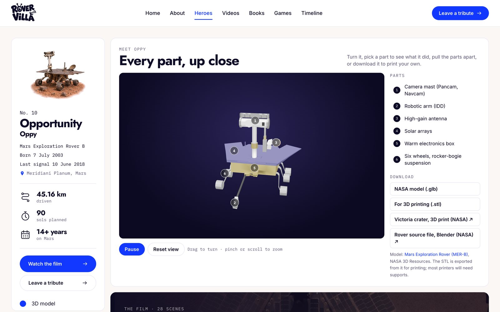

Each machine has a profile with:

- its catalogue card, mission stats and resting place
- its life's work, chapter by chapter, illustrated with archive photos
- the story of its last signal
- a credited photo gallery
- an interactive 3D parts explorer
- a tribute wall
- the full list of sources

Opportunity's page also has a scroll-driven cinematic story.

### 🧩 Turn them in your hands

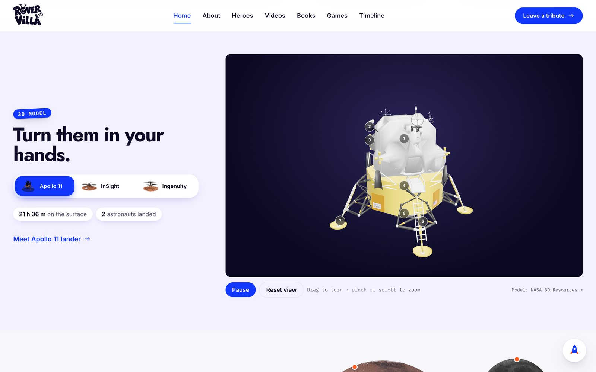

NASA's own textured 3D models of the Apollo Lunar Module, InSight, Ingenuity, the Viking lander and the Mars Exploration Rover, from [NASA 3D Resources](https://github.com/nasa/NASA-3D-Resources). Drag to turn and pinch to zoom. You can also:

- pick a numbered part to fly to it and learn what it did
- pull the parts apart with the explode slider
- download the model as GLB, or as STL for 3D printing

Machines without a NASA model get a simplified one built in code from NASA photos and descriptions, and the page says so.

### 📺 Watch

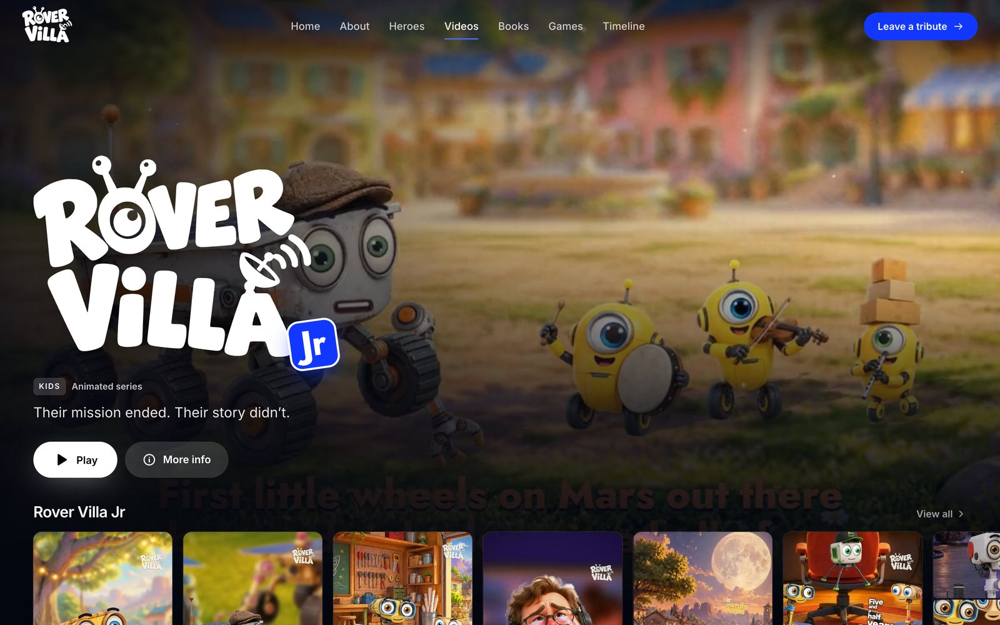

A streaming-style video section. It's home to **Rover Villa Jr**, an animated series in which the old machines live together in a little village and tell their stories, and it has a player that remembers where you stopped.

Hero pages embed real mission videos from their publishers' own YouTube channels.

### 🌍 Where they rest, and when

<table>
  <tr>
    <td width="50%">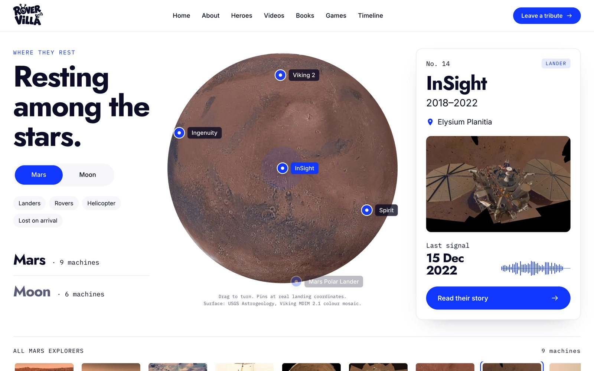</td>
    <td width="50%">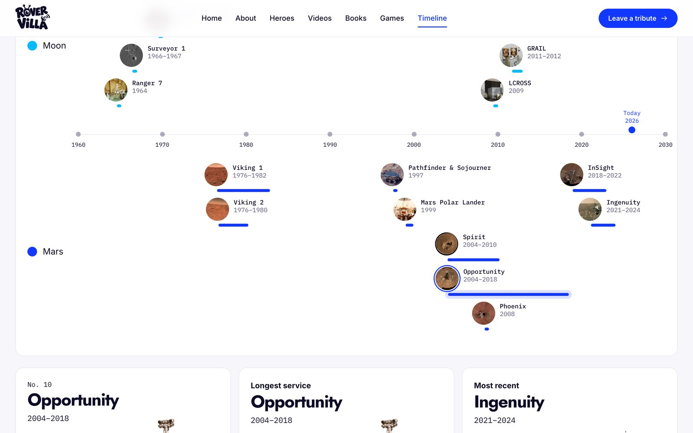</td>
  </tr>
  <tr>
    <td>Spin Mars and the Moon, built from real surface maps, and find every landing site at its published coordinates.</td>
    <td>Every machine on one axis, from Ranger 7 in 1964 to Ingenuity's last flight in 2024.</td>
  </tr>
</table>


### 📱 Made for phones


Phones get their own layouts, not a squeezed desktop page:

- a floating "liquid glass" tab bar and a glass bottom bar in the reader
- home sections that each fit on one screen
- swipe rows with dots that show there's more to the side

And a few small delights:

- a rover that drives along every footer
- a rocket that blasts you back to the top of the page
- stickers that straighten when you point at them
- confetti when you finish a chapter

---

## Built on real records

Rover Villa is meant to be a place you can truly learn from. Behind every page is a lot of reading: mission catalogues, engineering reports, review-board findings, flight journals and press releases. From those we pulled the dates, numbers, coordinates and quotes, and every one of them points back to where it came from.

**The rules we kept**

1. **Facts only.** Every date, number and "last words" line in `lib/heroes.ts` comes from a real source listed in that machine's `sources`. We never invent quotes.
2. **Imagined voices are labelled.** The books speak in the machine's voice. Those lines are retellings, not transmissions, and each book says so.
3. **Conflicting values stay attributed.** When two published sources disagree, we keep each value with its own source instead of averaging them into a new number.
4. **Unknowns stay unknown.** Where no source establishes something, such as a rover's exact final position, an unobserved failure moment, or the state of its electronics today, we say so.
5. **Games and art are not evidence.** Game physics, compressed timings, drawings and illustrations are there to explain. They are never presented as telemetry.
6. **Real photos are always credited.** Archive photos carry their NASA title, credit and source link, and are never mixed up with illustrations.

### How to trace a claim

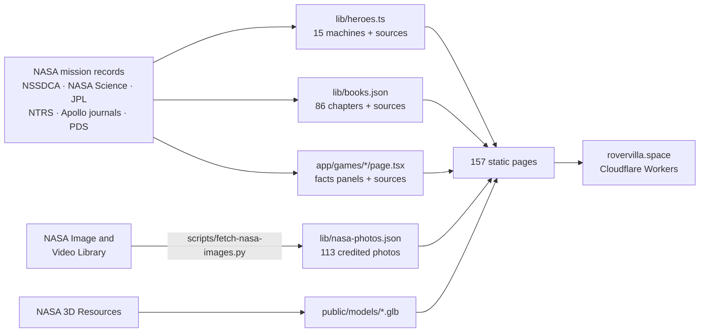

### Source families

| Source | What Rover Villa uses it for | Where it lives in the code |
|---|---|---|
| [NASA Space Science Data Coordinated Archive (NSSDCA)](https://nssdc.gsfc.nasa.gov/nmc/) | Catalogue identity (COSPAR IDs), launch and mission chronology, spacecraft and instrument descriptions, outcomes, published coordinates | `lib/heroes.ts` sources and links, `lib/books.json` chapter sources, game facts |
| [NASA Science mission pages](https://science.nasa.gov/missions/) | Mission summaries, key dates, science results, hardware explanations, end-of-mission context | `lib/heroes.ts`, `lib/wiki/*.ts`, book chapters, game facts |
| [NASA/JPL](https://www.jpl.nasa.gov/) and [NASA Photojournal](https://science.nasa.gov/photojournal/) | Engineering updates, discoveries, operations, final-contact reports, captions and archive image IDs | `lib/heroes.ts`, `lib/books.json`, `lib/nasa-photos.json` |
| [NASA Technical Reports Server (NTRS)](https://ntrs.nasa.gov/) | Mission reports, review-board findings, instrument and operations papers, exact numbers | Book chapters and fact files for LCROSS, Surveyor, Mars Polar Lander and others |
| [Apollo Lunar Surface Journal](https://www.nasa.gov/history/alsj/) and [Apollo Flight Journal](https://history.nasa.gov/afj/) | Apollo 11 and 15 transcripts, elapsed times, hardware actions, alarms, surface science and ascent | `lib/books.json` (Eagle, the Lunar Roving Vehicle), `lib/wiki/apollo-*.ts` |
| [Planetary Data System](https://pds.nasa.gov/) and [NAIF SPICE](https://naif.jpl.nasa.gov/naif/) | Archived images and data, instrument products, mission geometry | Source links for Ingenuity and the Mars Exploration Rovers |
| [LROC](https://www.lroc.asu.edu/) and [HiRISE](https://www.uahirise.org/) | Later orbital views of landing and impact sites, and the limits of what they can show | Book chapters and landing-site notes |
| [NASA Image and Video Library](https://images.nasa.gov/) | Archive image IDs, captions, credits and original media links | `lib/nasa-photos.json`, `lib/photos.ts`, `scripts/fetch-nasa-images.py` |
| [NASA 3D Resources](https://github.com/nasa/NASA-3D-Resources) | Textured 3D models of the Lunar Module, Viking, MER, InSight and Ingenuity | `public/models/*.glb`, `lib/parts.ts` |
| [NASA Astromaterials 3D](https://ares.jsc.nasa.gov/astromaterials3d/) | Apollo sample records | Lunar Roving Vehicle chapter sources |
| [USGS Astrogeology](https://astrogeology.usgs.gov/) and [LROC WAC via Moon Trek](https://trek.nasa.gov/moon/) | The Mars (Viking MDIM 2.1) and Moon (LROC WAC) surface maps on the globes | `public/textures/`, `app/components/globe.tsx` |

Across the machines, books and games, the code cites **196 unique source links on 21 domains**. The most cited are science.nasa.gov, jpl.nasa.gov, nasa.gov, NSSDCA and the NASA image archive.

### Mission by mission

**Moon**

| Machine | Catalogue record | Records used for | Code |
|---|---|---|---|
| **Ranger 7** | [NSSDCA 1964-041A](https://nssdc.gsfc.nasa.gov/nmc/spacecraft/display.action?id=1964-041A) · [NASA Science](https://science.nasa.gov/mission/ranger-7/) | Identity, the six-camera television system, picture count and timing, approach, impact and archive frames | `lib/heroes.ts`, `lib/wiki/ranger-7.ts`, book `ranger-7`, game `ranger-7-dive` |
| **Surveyor 1** | [NSSDCA 1966-045A](https://nssdc.gsfc.nasa.gov/nmc/spacecraft/display.action?id=1966-045A) · [NASA Science](https://science.nasa.gov/mission/surveyor-1/) | Propulsion and landing sequence, camera work, soil contact, surviving the lunar night, last contact, orbital identification | `lib/heroes.ts`, `lib/wiki/surveyor-1.ts`, book `surveyor-1` |
| **Apollo 11 lander · Eagle** | [NSSDCA 1969-059C](https://nssdc.gsfc.nasa.gov/nmc/spacecraft/display.action?id=1969-059C) · [NASA](https://www.nasa.gov/mission/apollo-11/) | The two stages, undocking, the 1201/1202 alarms, descent and landing, surface experiments, ascent, and what stayed behind | `lib/heroes.ts`, `lib/wiki/apollo-11-lander.ts`, book `apollo-11-lander`, 3D model |
| **Lunar Roving Vehicle** | [NSSDCA 1971-063C](https://nssdc.gsfc.nasa.gov/nmc/spacecraft/display.action?id=1971-063C) · [LRV record](https://nssdc.gsfc.nasa.gov/planetary/lunar/apollo_lrv.html) | Chassis, wheels, batteries, steering and navigation, deployment, traverses, samples, distance and time, final parking | `lib/heroes.ts`, `lib/wiki/apollo-15-rover.ts`, book `apollo-15-rover` |
| **LCROSS** | [NSSDCA 2009-031B](https://nssdc.gsfc.nasa.gov/nmc/spacecraft/display.action?id=2009-031B) · [NASA Science](https://science.nasa.gov/mission/lcross/) | The Centaur and LCROSS impact sequence, timing and speed, plume observations, spectroscopy, the water estimate with its uncertainty | `lib/heroes.ts`, `lib/wiki/lcross.ts`, book `lcross`, game `lcross-impact` |
| **GRAIL · Ebb & Flow** | [NSSDCA 2011-046A](https://nssdc.gsfc.nasa.gov/nmc/spacecraft/display.action?id=2011-046A) · [NASA Science](https://science.nasa.gov/mission/grail/) | The twins, orbit insertion, the range-rate method, MoonKAM, gravity maps, the controlled impacts | `lib/heroes.ts`, `lib/wiki/grail.ts`, book `grail`, game `grail-gravity` |

**Mars**

| Machine | Catalogue record | Records used for | Code |
|---|---|---|---|
| **Viking 1** | [NSSDCA 1975-075C](https://nssdc.gsfc.nasa.gov/nmc/spacecraft/display.action?id=1975-075C) · [NASA Science](https://science.nasa.gov/mission/viking-1/) | Landing, cameras, weather, the sampler and biology instruments, their uncertain results, mission end | `lib/heroes.ts`, `lib/wiki/viking.ts`, book `viking-1`, game `viking-biology`, 3D model |
| **Viking 2** | [NSSDCA 1975-083C](https://nssdc.gsfc.nasa.gov/nmc/spacecraft/display.action?id=1975-083C) · [NASA Science](https://science.nasa.gov/mission/viking-2/) | Utopia Planitia operations, seasonal frost, power and communications, mission end | `lib/heroes.ts`, `lib/wiki/viking.ts`, book `viking-2`, 3D model |
| **Pathfinder & Sojourner** | [NSSDCA 1996-068A](https://nssdc.gsfc.nasa.gov/nmc/spacecraft/display.action?id=1996-068A) · [NASA Science](https://science.nasa.gov/mission/mars-pathfinder/) | Airbag landing, rollout, the lander and rover roles, APXS, hazard avoidance, totals, last data, the rover's unknown final moves | `lib/heroes.ts`, `lib/wiki/pathfinder-sojourner.ts`, book `pathfinder-sojourner` |
| **Mars Polar Lander** | [NSSDCA 1999-001A](https://nssdc.gsfc.nasa.gov/nmc/spacecraft/display.action?id=1999-001A) · [NASA Science](https://science.nasa.gov/mission/mars-polar-lander-deep-space-2/) | Mission sequence, loss of contact, the missing descent data, the review board's probable cause, the uncertain final site | `lib/heroes.ts`, `lib/wiki/mars-polar-lander.ts`, book `mars-polar-lander`, game `polar-lander-forensics` |
| **Spirit** | [NSSDCA 2003-027A](https://nssdc.gsfc.nasa.gov/nmc/spacecraft/display.action?id=2003-027A) · [NASA Science](https://science.nasa.gov/mission/mer-spirit/) | Landing and traverse, instruments, the broken wheel, the silica discovery, winter operations, final contact | `lib/heroes.ts`, `lib/wiki/spirit.ts`, book `spirit`, game `mer-twins`, 3D model |
| **Opportunity** | [NSSDCA 2003-032A](https://nssdc.gsfc.nasa.gov/nmc/spacecraft/display.action?id=2003-032A) · [NASA Science](https://science.nasa.gov/mission/mer-opportunity/) | Airbag landing, hematite "blueberries", the marathon distance, memory and power operations, the 2018 dust storm, final contact | `lib/heroes.ts`, `lib/wiki/opportunity.ts`, `lib/stories/opportunity.ts`, book `opportunity`, game `mer-twins`, 3D model |
| **Phoenix** | [NSSDCA 2007-034A](https://nssdc.gsfc.nasa.gov/nmc/spacecraft/display.action?id=2007-034A) · [NASA Science](https://science.nasa.gov/mission/phoenix/) | Landing, the robotic arm and its instruments, exposed ice, water, perchlorate and snow, the last signal, later orbital views | `lib/heroes.ts`, `lib/wiki/phoenix.ts`, book `phoenix` |
| **InSight** | [NSSDCA 2018-042A](https://nssdc.gsfc.nasa.gov/nmc/spacecraft/display.action?id=2018-042A) · [NASA Science](https://science.nasa.gov/mission/insight/) | Landing, placing the seismometer, marsquakes, the heat probe, what it learned about Mars's interior, dust and power, final contact | `lib/heroes.ts`, `lib/wiki/insight.ts`, book `insight`, game `insight-seismology`, 3D model |
| **Ingenuity** | [NSSDCA 2020-052A](https://nssdc.gsfc.nasa.gov/nmc/spacecraft/display.action?id=2020-052A) · [NASA Science](https://science.nasa.gov/mission/mars-2020-perseverance/ingenuity-mars-helicopter/) | Hardware and mass, the first flight, the 72-flight record, the final flight and blade damage | `lib/heroes.ts`, `lib/wiki/ingenuity.ts`, book `ingenuity`, game `ingenuity-flight`, 3D model |

Books live in `lib/books.json` under each machine's slug. Every chapter has a main `source`, `related` links and a `facts` list, and each fact can carry its own source. Game facts live in `app/games/<game>/page.tsx`. The playable part sits next to it in `game.tsx`.

### Photos, coordinates and uncertainty

- **Archive photos.** IDs, titles, credits and links are in `lib/nasa-photos.json`, downloaded with `scripts/fetch-nasa-images.py` from the NASA Image and Video Library. Every photo shows its credit where it appears.
- **Coordinates.** Landing sites in `lib/heroes.ts` use published coordinates. Approximate ones, like Mars Polar Lander's presumed site, are marked `approx` and labelled as presumed.
- **Later orbital images.** LROC and HiRISE pictures can identify a site or the hardware, but not whether its electronics still work. The text never claims more.
- **Illustrations.** The machine cut-outs, scenes and book art are made for this project. They are not archive photos, and they are not evidence of terrain, geometry or the state of the hardware.

### Reviewer checklist

For any date, number, coordinate, quote or engineering claim:

1. Find the machine in the tables above.
2. Open its `sources` in `lib/heroes.ts`, or the chapter's `source` and `facts` in `lib/books.json`.
3. Follow the original link and find the passage.
4. Check that the wording doesn't claim more precision than the source does.
5. Check that imagined narration is never presented as a recorded transmission.
6. Check that game values are illustrative unless they're shown as a cited fact.

If a claim can't complete that chain, it gets qualified, marked as unknown, or removed.

---

## How it's built

| Layer | What we use |
|---|---|
| Framework | [Next.js 16](https://nextjs.org) App Router. Every page is statically generated: 157 routes, using `generateStaticParams` |
| UI | React 19, TypeScript 5, [Tailwind CSS 4](https://tailwindcss.com) with design tokens, plus Inter, Jost, IBM Plex Mono and Caveat via `next/font` |
| 3D | [three.js](https://threejs.org) for the globes, the textured NASA models (Draco-compressed glTF) and Touchdown's 3D landing |
| Motion | [GSAP](https://gsap.com) ScrollTrigger, CSS keyframes and an IntersectionObserver reveal. All of it respects `prefers-reduced-motion` |
| Games | Canvas 2D with a shared `requestAnimationFrame` hook, high-DPI canvases, seeded random terrain and Web Audio sound |
| Reading | Web Speech API read-aloud, plus reading and watch progress in `localStorage` through `useSyncExternalStore` |
| Hosting | [OpenNext](https://opennext.js.org/cloudflare) on Cloudflare Workers, with the Cloudflare Images binding and custom domains. Videos stream from Cloudflare Pages |
| SEO | Per-page metadata and Open Graph, `sitemap.xml`, `robots.txt` and JSON-LD |

**Under the hood**

- **One source of truth.** Add a machine to `lib/heroes.ts` and its profile, globe pin, timeline entry, tribute wall and sitemap entry all appear.
- **Heavy things load late.** three.js, the textures and each model only load when they near the screen, and rendering pauses when they scroll away. The home page fetches only the 3D model you pick.
- **Phones first.** Separate phone layouts, swipe rows with snap points and scroll dots, a sliding glass tab bar, and safe-area padding for notched screens.
- **Accessible by default.** Real buttons and links, labelled controls and keyboard support: the arrow keys turn chapters and flip through the bookshelf.

### Project structure

```
app/
├─ page.tsx                 Home
├─ heroes/[slug]/           Machine profiles (+ story/ for the cinematic story)
├─ books/[slug]/[chapter]/  Book pages and the comic / storybook reader
├─ games/<game>/            Nine games: page.tsx (facts) + game.tsx (play)
├─ videos/ · series/[slug]/ Video catalogue, Rover Villa Jr, player
├─ timeline/ · where-they-rest/ · tributes/ · about/
├─ components/              Shared UI: header, tab bar, globe, 3D studio, reader…
└─ globals.css              Tokens, liquid glass and the playful layer
lib/
├─ heroes.ts                The archive: 15 machines, facts and sources
├─ books.json · books.ts    15 books, 86 chapters, each with sources
├─ nasa-photos.json         113 credited NASA archive photos
├─ wiki/ · stories/         Longer mission background and the cinematic story
├─ parts.ts · models/       3D part hotspots and code-built models
└─ videos.ts                Rover Villa Jr episodes and credits
public/
├─ models/                  NASA 3D Resources models (.glb)
├─ textures/                Mars and Moon surface maps
└─ images/nasa/             Archive photos
scripts/
├─ fetch-nasa-images.py     Downloads archive photos and writes nasa-photos.json
└─ generate-assets.mjs      Rebuilds the illustrations
design/                     The original page designs
CONCEPT.md                  The idea, the sections and the voice
```

---

## Run it yourself

You need Node.js 20 or newer.

```bash
git clone https://github.com/asfi50/rovervilla.git
cd rovervilla
npm install
npm run dev            # http://localhost:3000
```

| Command | What it does |
|---|---|
| `npm run dev` | Development server |
| `npm run build && npm start` | Production build, served locally |
| `npm run lint` | ESLint |
| `npm run preview` | Build for Cloudflare and preview it in the Workers runtime |
| `npm run deploy` | Build and deploy to Cloudflare Workers. It needs `wrangler login`, and your own domains in `wrangler.jsonc` |
| `python3 scripts/fetch-nasa-images.py` | Download or refresh the NASA archive photos |

**Docker:** `docker build -t rovervilla . && docker run -p 3000:3000 rovervilla`. This uses standalone output, with a health check at `/api/health`.

**Environment** (`.env.example`):

- `NEXT_PUBLIC_SITE_URL` sets the canonical site address. It's optional and defaults to `https://rovervilla.space`.
- `OPENROUTER_API_KEY` is only needed for `npm run assets`.

### Adding a machine

1. Add it to `lib/heroes.ts` with its facts and a `sources` list. Every date and number needs a source.
2. Add its archive photo IDs to `scripts/fetch-nasa-images.py` and run the script.
3. Optionally, add its book to `lib/books.json`, its 3D model to `public/models/` with hotspots in `lib/parts.ts`, and its background to `lib/wiki/`.

---

## Credits

- **Mission records:** NSSDCA, NASA Science, NASA/JPL, NTRS, the Apollo Lunar Surface and Flight Journals, PDS, NAIF, LROC, HiRISE and the Lunar and Planetary Institute. Each one is linked where it is used.
- **Photos:** the [NASA Image and Video Library](https://images.nasa.gov/), with every photo credited to its original mission team.
- **3D models:** [NASA 3D Resources](https://github.com/nasa/NASA-3D-Resources).
- **Surface maps:**
  - Mars: USGS Astrogeology, Viking MDIM 2.1 colour mosaic.
  - Moon: NASA/GSFC/Arizona State University LROC WAC mosaic, via NASA Moon Trek.
- **Music in Rover Villa Jr:**
  - "Trivial Call" by Blue Dot Sessions (CC BY 3.0)
  - "Bouncing" by HoliznaCC0 (CC0)
  - "Crazy Glue" by Josh Woodward (CC BY 3.0)
  - "Wildflowers" by Scott Buckley (CC BY 4.0)
  - Six tracks by Kevin MacLeod, incompetech.com (CC BY 4.0)
  - The full list is in `lib/videos.ts`.
- **Fonts:** Inter, Jost, IBM Plex Mono and Caveat, from Google Fonts.
- **NASA source map:** the mission traceability in this README is adapted from the Rover Villa team's [NASA references guide](https://github.com/AhmedTrooper/The_LastSignal/blob/dev/docs/NASA_REFERENCES_2_OUR_CODE/README.md).

<br>

<div align="center">

Rover Villa is an independent memorial. It is not affiliated with or endorsed by NASA or any space agency, and it uses no agency logos or branding.

NASA photos and models are used under [NASA's media guidelines](https://www.nasa.gov/nasa-brand-center/images-and-media/).

<br>


**[rovervilla.space](https://rovervilla.space)**

</div>
